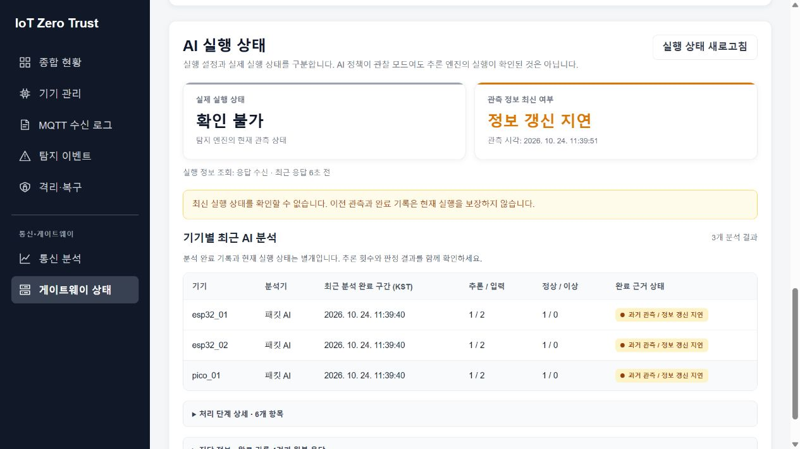
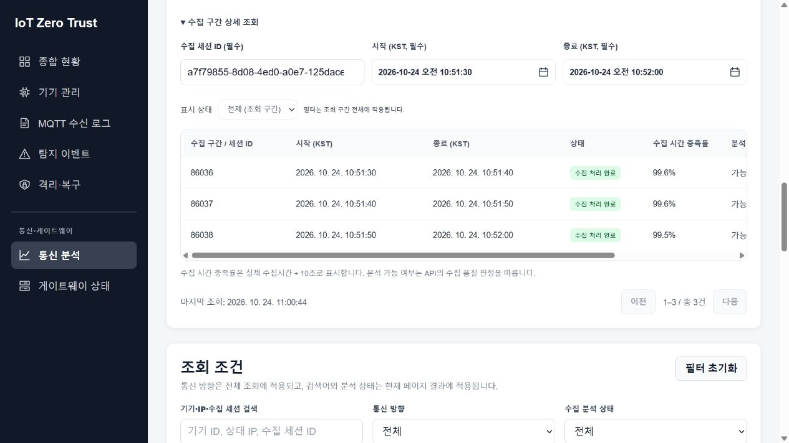

# 대시보드 상태 표시·통신 분석 화면 검증

- 기준: `develop`의 `aa73ebae47d2e39a4134c4ddf34ae7c9f53907a1`
- 브랜치: `feature/woomin-dashboard-ui-polish`
- 환경: Windows, Node.js 24.19.0, Vite 8.1.0, 실제 Raspberry Pi 조회 API에 연결한 로컬 프런트엔드
- 범위: 프런트엔드 표시·조회 요청과 회귀 테스트. DB, 수집기, 탐지 정책, 모델, 임계값, Pi 서비스는 변경하지 않음.

## 자동 검증

| 검증 | 실행 방법 | 결과 |
| --- | --- | --- |
| 프런트엔드 회귀 | `frontend/package.json`의 `test`와 동일한 파일 목록으로 `node --test` 실행 | 통과: 74개, 실패 0개, skip 0개 |
| 전체 린트 | `oxlint` | 통과: 오류 0개. 기존 경고 4개: Isolation의 미사용 변수, DeviceTrafficTrends의 effect 의존성, Logs의 미사용 함수 2개 |
| 프로덕션 빌드 | Vite `build()`를 `configLoader: native`와 별도 출력 폴더로 실행 | 통과: 539개 모듈. 압축 JS 약 912 kB이며 500 kB 초과 경고가 남음 |
| 변경 범위 | 최신 develop에 diff 패치를 적용하고 미리보기와 비교 | 프런트엔드 16개 파일이 줄바꿈 정규화 후 동일 |

재현 시 `frontend`에서 `npm ci`, `npm test`, `npm run lint`, `npm run build -- --configLoader native`를 실행한다. 검증에는 이미 설치된 동일 lockfile의 의존성을 재사용했다.

회귀는 다음 의미를 확인한다.

- 오래된 관측, 조회 실패, 누락된 시각·유효기간을 현재 실행 중으로 표시하지 않는다.
- 상세 정보를 접어도 현재 단계 실패, 엔진 중지, 정보 갱신 지연 경고가 남는다. 의도적으로 사용 중지한 단계는 오류로 표시하지 않는다.
- 기기·분석기별 최신 완료 결과만 요약하며 모든 완료 기록, 모델 정보와 원본 JSON은 진단 정보에 보존한다.
- 없는 MQTT 건수와 빈 조회를 0으로 바꾸지 않는다.
- 수집 시간 충족률을 실제 수집시간으로 표시하며 `capture_eligible` 판정을 다시 계산하지 않는다.
- Packet 조회 종료 상한을 보정해 다음 10초 구간이 선택 기간에 섞이지 않는다. 다른 기기·기간·방향의 응답을 거부하는 검사는 유지한다.

## 실제 API와 브라우저 확인

| 화면·시나리오 | 관측 결과 |
| --- | --- |
| 종합 현황 | 실제 실행 상태와 관측 정보, 선택 수집 세션의 품질 요약을 표시하고 원본은 접어서 확인 |
| 격리·복구 | 요약 → 현재 격리된 기기 → 실제 방화벽 상태 → 이력 순서. 실제 규칙 일치·관측 시각을 요약하고 원본은 접기 |
| 게이트웨이 상태 | 자원·인터페이스를 먼저 표시. AI 영역은 요약 2개, 기기별 표, 접힌 상세 정보로 구성 |
| AI 정보 갱신 지연 | 조회 응답은 수신했지만 실제 관측 시각이 오래된 경우 실행 상태는 확인 불가, 완료 기록은 과거 관측으로 표시 |
| AI 상세 펼치기 | 처리 단계 6개, 완료 기록 4개를 확인. 기기명이 없는 과거 기록과 모델·분석 제외 근거를 유지 |
| MQTT 추이 | esp32_01의 고정 기간 조회에서 171개 분석 구간과 메시지 합계 341건을 표시. 전체 누적 통계와 구분 |
| Packet 추이 | 같은 기간·기기의 INBOUND 171개 분석 구간을 표시하고 품질 미확인·제외는 별도로 집계 |
| Packet 종료 경계 | API의 `window_start <= to` 조건 때문에 종료 01:52:00에 시작한 다음 구간이 포함되던 응답을 확인. 요청 상한을 01:51:50으로 맞춰 마지막 구간이 선택 종료 시각에 끝나게 수정 |
| 수집 구간 표 | 열 간격·배경·페이지 이동을 정리. 실제 수집시간 9.923846초는 99.2%로 표시하고 자료가 없으면 계산 불가로 유지 |
| 탐지 이벤트 | 요약 카드의 Capture Gap을 수집 공백으로 표시. 내부 이벤트 코드는 유지 |

위 화면은 실제 API의 정보 갱신 지연 상태를 보존한 예시다. 정상 실행·단계 실패·조회 실패·빈 결과의 경계는 자동 회귀로도 확인했다.

## 검증 경계

- 실제 장비에는 조회 API GET만 사용했으며 Pi의 코드·서비스·운영 설정을 배포하지 않았다.
- 새 화면의 모든 기기·기간·브라우저 조합을 전수 검사한 것은 아니다. 고정 기간의 MQTT·Packet 전환과 주요 화면, 자동 회귀에 포함된 오류·빈 결과를 확인했다.
- 작성자 외 팀원의 코드·증거 검토와 승인은 병합 전에 별도로 필요하다.
